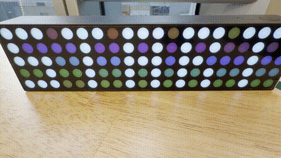
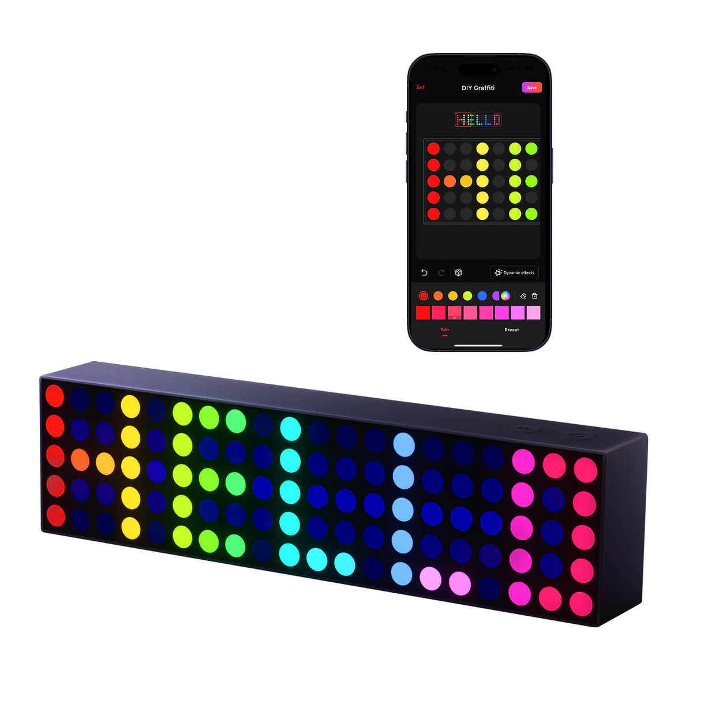

# yeelight-claude-hook

> Visual feedback for Claude Code using Yeelight RGB lights

[](https://github.com/jacobke/yeelight-claude-hook)
[](https://www.python.org/)
[](LICENSE)

<table>
  <tr>
    <td></td>
    <td></td>
  </tr>
</table>

**Yeelight Smart Lamp Cube Lite**

**English** | [中文](README_CN.md)

## Features

- 🌈 **Visual Effects** - Different light effects for different states
- 🕯️ **Candle Mode** - Flickering candle effect while thinking
- 💚 **Task Complete** - Green breathing light on completion
- ⚡ **Real-time Response** - Interruptible effects, new commands take effect immediately
- 🔌 **Long Connection** - Daemon mode avoids device connection quota limits
- 🔢 **Instance Marking** - Gold pixel shows Claude Code instance number (1-5)
- 📊 **Quota Meter** - Progress bars show remaining MiniMax Token Plan allowance
- 💳 **Cursor balance** - included usage spent and remaining this billing cycle

## Demo

| State | Effect | Trigger |
|-------|--------|---------|
| START | Rainbow background + white text | User sends message |
| THINK | Candle flickering | Tool execution starts |
| DONE | Blue fade in/out | Tool execution ends |
| INPUT | Purple wave | Waiting for user input |
| Complete | Green breathing (infinite) | Task completed successfully |
| ERROR | Red flashing | Error occurred |

### Token Plan Meter

When the lamp is idle, it shows your remaining MiniMax Token Plan allowance as two
progress bars — the 5-hour rolling window on top, the weekly window below. The bar
length is the remaining percentage; the color tracks how urgent it is
(green → yellow → red for the 5-hour window, cyan → blue → purple for the weekly one).

```
row4 |██████████████······|   ← 5-hour window
row3 |██████████████······|
row2 |····················|
row1 |█████···············|   ← weekly window
row0 |█████···············|
```

## DeepSeek Balance Page

If you use DeepSeek's pay-as-you-go API, the lamp gains a second page that
alternates with the MiniMax page every 10 seconds:

```
|███·███ ··███·███|    magenta = spent today
|··█···█ ····█·█·█|    white   = account balance
|███·███ ··███·███|
|█·····█ ····█·█·█|
|███·█··█ ··███·███|
```

- **Spent today** = the balance first seen today minus the current balance.
  DeepSeek has no public spend query API, so this is derived from balance changes.
- The baseline is stored in `deepseek_state.json` (git-ignored) and survives restarts.
- When both amounts are large, the page switches to alternating the two values.
- Balances of 10,000+ are abbreviated as `12K` / `1.2M`.
- **Transition**: pages cross-fade over 3 frames (~3 s) instead of hard-cutting. Tune with `rotation.transition_frames`; set it to 0 for an instant switch.

Configure `deepseek.api_key` in `config.json`. If Claude Code is already pointed at
DeepSeek in `~/.claude/settings.json`, that key is reused automatically.
Disable with `--no-deepseek` or `"deepseek": { "enabled": false }`.

## Cursor balance page

**Off by default.** Cursor has no stable public API; usage is read from the local
desktop login (on macOS that usually requires Keychain decryption), so this page
is opt-in. Enable with `"cursor": { "enabled": true }` in `config.json`.

When enabled, after you sign in to the Cursor desktop app, the lamp adds another
page to the rotation. Values are included usage for the current billing cycle:
dollars when the API returns them, otherwise used/remaining percentages
(for example `4.2` spent and `16` left).

- No separate API key. The daemon reads tokens from local `state.vscdb`, decrypts
  newer sealed tokens with the macOS **Cursor Safe Storage** Keychain item, and does
  not write tokens back. The first read may prompt for Keychain access.
- Same undocumented billing API the Cursor app uses; response shape can change.
- Large values alternate on one page, same as the DeepSeek page.
- Disable with `--no-cursor` or `"cursor": { "enabled": false }` (omit `cursor` = off).

## Quick Start

### 1. Discover Device IP

```bash
python3 discover.py
```

### 2. Configure Auto-start

Edit `com.yeelight.daemon.plist.template`:
- Update path to `yeelight-daemon.py`
- Update device IP address
- (Optional) Set instance number (1-20) for pixel marking

```bash
cp com.yeelight.daemon.plist.template ~/Library/LaunchAgents/com.yeelight.daemon.plist
launchctl load ~/Library/LaunchAgents/com.yeelight.daemon.plist
```

**Instance Marking**: When running multiple Claude Code instances, set different `--instance` numbers (1-5). A gold pixel will appear at the rightmost column to identify which instance is active.

| Instance | Pixel Position |
|----------|----------------|
| 1 | Top-right corner (row 4) |
| 2 | 2nd row from top (row 3) |
| 3 | Middle row (row 2) |
| 4 | 4th row from top (row 1) |
| 5 | Bottom-right corner (row 0) |

### 3. Configure Claude Code Hooks

Add to `~/.claude/settings.json`:

```json
{
  "hooks": {
    "UserPromptSubmit": [{
      "hooks": [{ "command": "python3 /path/to/yeelight-client.py --state start --duration 2", "type": "command" }]
    }],
    "PreToolUse": [{
      "hooks": [{ "command": "python3 /path/to/yeelight-client.py --state thinking", "type": "command" }]
    }],
    "PostToolUse": [{
      "hooks": [{ "command": "python3 /path/to/yeelight-client.py --state done", "type": "command" }]
    }],
    "Notification": [{
      "hooks": [{ "command": "python3 /path/to/yeelight-client.py --state wait", "type": "command" }]
    }],
    "Stop": [{
      "hooks": [{ "command": "python3 /path/to/yeelight-client.py --state complete", "type": "command" }]
    }],
    "StopFailure": [{
      "hooks": [{ "command": "python3 /path/to/yeelight-client.py --state interrupt", "type": "command" }]
    }],
    "PostToolUseFailure": [{
      "hooks": [{ "command": "python3 /path/to/yeelight-client.py --state interrupt", "type": "command" }]
    }]
  }
}
```

### 4. Test

```bash
python3 yeelight-client.py --state done
```

### 5. Token Plan Meter (Optional)

Copy `config.json.example` to `config.json` and fill in your MiniMax subscription key
(`config.json` is git-ignored):

```json
{
  "ip": "192.168.1.100",
  "instance": 0,
  "minimax": {
    "enabled": true,
    "api_base": "https://api.minimaxi.com",
    "api_key": "sk-your-minimax-subscription-key",
    "poll_interval": 300,
    "takeover_delay": 20
  }
}
```

Use a **subscription key** from the Token Plan page, not a pay-as-you-go API key —
the quota endpoint rejects the latter. For the international site use
`https://api.minimax.io` as `api_base`.

The API key is resolved in this order: `--minimax-api-key` → `MINIMAX_API_KEY`
environment variable → `config.json` → `ANTHROPIC_AUTH_TOKEN` in
`~/.claude/settings.json` (a zero-config shortcut if you already point Claude Code at
MiniMax).

Check what the daemon resolved without touching the device:

```bash
python3 yeelight-daemon.py --dry-run
```

Force an immediate repaint:

```bash
python3 yeelight-client.py --state minimax
```

The meter only paints while the lamp is idle — hook effects take priority, and the
meter returns once they finish (after `takeover_delay` seconds, so the green
"task complete" breathing light stays visible for a while). If the API cannot be
reached the lamp keeps showing the last good reading rather than going dark.

## Files

| File | Description |
|------|-------------|
| `yeelight-daemon.py` | Background service with TCP connection |
| `yeelight-client.py` | Client for Unix Socket communication |
| `yeelight-hook.py` | Standalone script (not recommended) |
| `discover.py` | Discover Yeelight devices on LAN |
| `minimax.py` | MiniMax Token Plan client and quota bar rendering |
| `config.py` | Configuration loading (config.json, env vars, CLI) |
| `com.yeelight.daemon.plist.template` | launchd template |

## Architecture

```
Claude Code Hooks → yeelight-client.py → Unix Socket → yeelight-daemon
                                                        ↓
                                                   Yeelight Device
```

## Requirements

- Yeelight device with LAN Control enabled (Geek Mode)
- Python 3 (no additional dependencies)
- macOS or Linux

## Troubleshooting

See [TROUBLESHOOTING.md](TROUBLESHOOTING.md)

## Resources

- [TapHome Yeelight Compatibility](https://taphome.com/en/compatibility/yeelight/)
- [Yeelight Forum - Command Limits](https://forum.yeelight.com/t/topic/15756/15)

## License

[MIT License](LICENSE)
