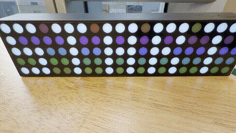
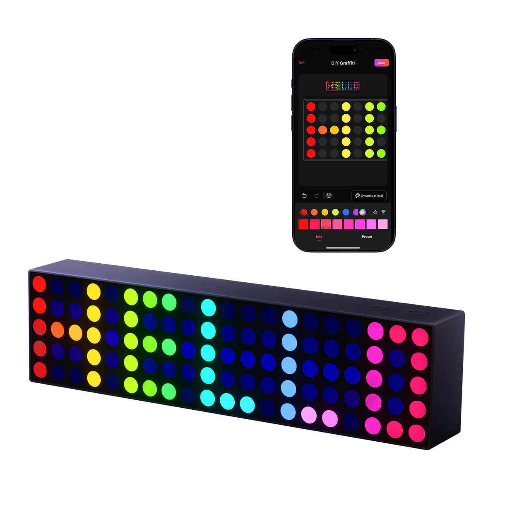

# yeelight-claude-hook

> Yeelight 灯光效果 for Claude Code - 在不同运行阶段显示视觉反馈

[](https://github.com/jacobke/yeelight-claude-hook)
[](https://www.python.org/)
[](LICENSE)

<table>
  <tr>
    <td></td>
    <td></td>
  </tr>
</table>

**Yeelight Smart Lamp Cube Lite**

[English](README.md) | **中文**

## 功能特性

- 🌈 **视觉效果** - 不同状态显示不同灯光效果
- 🕯️ **蜡烛模式** - 思考时显示蜡烛闪烁效果
- 💚 **任务完成** - 绿色呼吸灯表示任务完成
- ⚡ **实时响应** - 效果可中断，新命令立即生效
- 🔌 **长连接** - Daemon 模式避免设备连接配额限制
- 🔢 **实例标记** - 土豪金像素显示 Claude Code 实例编号 (1-5)
- 📊 **配额进度条** - 展示 MiniMax Token Plan 剩余额度

## 效果预览

| 状态 | 效果 | 颜色 | 触发时机 |
|------|------|------|----------|
| start | START | 彩虹背景+白字 | 用户发送消息 |
| thinking | THINK | 暖黄-橙色 | 蜡烛火焰闪烁 |
| done | DONE | 柔和蓝色 | 渐入→保持→渐出 |
| wait | INPUT | 紫色 | 波浪效果 |
| complete | 绿色呼吸 | 绿色 | 内置呼吸效果（无限循环） |
| interrupt | ERROR | 红色 | 快闪 5 次 |
| end | END | 红色 | 渐出关灯 |

## 配额进度条

空闲时，灯上显示 MiniMax Token Plan 的剩余额度：上 2 行是 5 小时滚动窗口，
下 2 行是周窗口。条的长度就是剩余百分比，颜色随余量变紧张
（5h 绿→黄→红，周 青→蓝→紫）。

```
row4 |██████████████······|   ← 5 小时窗口
row3 |██████████████······|
row2 |····················|
row1 |█████···············|   ← 周窗口
row0 |█████···············|
```

## DeepSeek 余额页

如果你用 DeepSeek 的按量计费 API，灯上会多一页，与 MiniMax 页每 10 秒轮播：

```
|███·███ ··███·███|    品红 = 今日消费
|··█···█ ····█·█·█|    白色 = 账户余额
|███·███ ··███·███|
|█·····█ ····█·█·█|
|███·█··█ ··███·███|
```

- **今日消费** = 当天第一次看到的余额 − 当前余额。DeepSeek 没有公开的消费查询接口，
  所以这个值是 daemon 自己按余额变化算出来的
- 基线保存在 `quota_state.json`（已 gitignore），重启 daemon 不会丢失
- 金额较大时（3 位数 + 3 位数放不下）会自动改为同一页内轮流显示
- 余额 5 位以上会缩写成 `12K` / `1.2M`

**配置**：在 `config.json` 里加 `deepseek.api_key`。如果 `~/.claude/settings.json`
已经把 Claude Code 指向 DeepSeek，会自动复用那个 key，不用额外配置。

```json
"deepseek": { "enabled": true, "api_key": "sk-your-deepseek-key" }
```

关闭这一页：`--no-deepseek` 或 `"deepseek": { "enabled": false }`。

## 快速开始

### 1. 发现设备 IP

```bash
python3 discover.py
```

### 2. 配置开机自启

编辑 `com.yeelight.daemon.plist.template`：
- 修改 `/path/to/yeelight-daemon.py` 为实际路径
- 修改 `YOUR_YEELIGHT_IP` 为设备 IP
- （可选）设置实例编号 (1-20) 用于像素标记

```bash
cp com.yeelight.daemon.plist.template ~/Library/LaunchAgents/com.yeelight.daemon.plist
launchctl load ~/Library/LaunchAgents/com.yeelight.daemon.plist
```

**实例标记**：当运行多个 Claude Code 实例时，设置不同的 `--instance` 编号 (1-5)。最右边列会显示土豪金像素来标识当前活跃的实例。

| 实例 | 像素位置 |
|------|----------|
| 1 | 右上角 (第4行) |
| 2 | 右数第二行 (第3行) |
| 3 | 中间行 (第2行) |
| 4 | 右数第四行 (第1行) |
| 5 | 右下角 (第0行) |

### 3. 配置 Claude Code Hooks

在 `~/.claude/settings.json` 中添加：

```json
{
  "hooks": {
    "UserPromptSubmit": [{
      "hooks": [{ "command": "python3 /path/to/yeelight-client.py --state start --duration 2", "type": "command" }]
    }],
    "PreToolUse": [{
      "hooks": [{ "command": "python3 /path/to/yeelight-client.py --state thinking", "type": "command" }]
    }],
    "PostToolUse": [{
      "hooks": [{ "command": "python3 /path/to/yeelight-client.py --state done", "type": "command" }]
    }],
    "Notification": [{
      "hooks": [{ "command": "python3 /path/to/yeelight-client.py --state wait", "type": "command" }]
    }],
    "Stop": [{
      "hooks": [{ "command": "python3 /path/to/yeelight-client.py --state complete", "type": "command" }]
    }],
    "StopFailure": [{
      "hooks": [{ "command": "python3 /path/to/yeelight-client.py --state interrupt", "type": "command" }]
    }],
    "PostToolUseFailure": [{
      "hooks": [{ "command": "python3 /path/to/yeelight-client.py --state interrupt", "type": "command" }]
    }]
  }
}
```

### 4. 验证

```bash
python3 yeelight-client.py --state done
```

### 5. 配额进度条（可选）

把 `config.json.example` 复制成 `config.json`，填入 MiniMax 订阅 key
（`config.json` 已在 .gitignore 中）：

```json
{
  "ip": "192.168.1.100",
  "instance": 0,
  "minimax": {
    "enabled": true,
    "api_base": "https://api.minimaxi.com",
    "api_key": "sk-your-minimax-subscription-key",
    "poll_interval": 300,
    "takeover_delay": 20
  }
}
```

必须用 Token Plan 页面上的**订阅 key**，按量计费的 API key 会被配额接口拒绝。
国际站请把 `api_base` 改成 `https://api.minimax.io`。

API key 的取值顺序：`--quota-api-key` → 环境变量 `MINIMAX_API_KEY` →
`config.json` → `~/.claude/settings.json` 里的 `ANTHROPIC_AUTH_TOKEN`
（如果你已经把 Claude Code 指向 MiniMax，这条是零配置捷径）。

查看 daemon 解析出的配置（不连设备）：

```bash
python3 yeelight-daemon.py --dry-run
```

手动强制刷新一次：

```bash
python3 yeelight-client.py --state quota
```

配额条只在灯空闲时显示 —— hook 效果优先，效果结束后（延迟 `takeover_delay` 秒，
让"任务完成"的绿色呼吸灯多亮一会儿）配额条再接管。接口不可达时灯会继续显示上一次
的读数，而不是熄灭。

## 文件说明

| 文件 | 说明 |
|------|------|
| `yeelight-daemon.py` | 后台服务，保持 TCP 长连接 |
| `yeelight-client.py` | 客户端，通过 Unix Socket 通信 |
| `yeelight-hook.py` | 独立脚本模式（备用） |
| `discover.py` | 发现局域网内的 Yeelight 设备 |
| `quota.py` | MiniMax 配额查询与进度条渲染 |
| `config.py` | 配置加载（config.json、环境变量、命令行） |
| `com.yeelight.daemon.plist.template` | launchd 配置模板 |

## 架构说明

```
Claude Code Hooks → yeelight-client.py → Unix Socket → yeelight-daemon
                                                        ↓
                                                   Yeelight 设备
```

## 要求

- Yeelight 设备需开启"极客模式" (LAN Control / Developer Mode)
- Python 3（无需额外依赖）
- macOS 或 Linux

## 故障排查

详见 [TROUBLESHOOTING.md](TROUBLESHOOTING.md)

### 快速排查

```bash
# 检查 daemon 是否运行
ls -la /tmp/yeelight.sock

# 重启 daemon
launchctl unload ~/Library/LaunchAgents/com.yeelight.daemon.plist
launchctl load ~/Library/LaunchAgents/com.yeelight.daemon.plist

# 设备不可达
ping <设备IP>

# 手动测试
echo '{"state": "done"}' | nc -U /tmp/yeelight.sock
```

## 相关资源

- [TapHome Yeelight 兼容性说明](https://taphome.com/en/compatibility/yeelight/)
- [Yeelight 论坛 - 命令限制讨论](https://forum.yeelight.com/t/topic/15756/15)

## 许可证

[MIT License](LICENSE)
